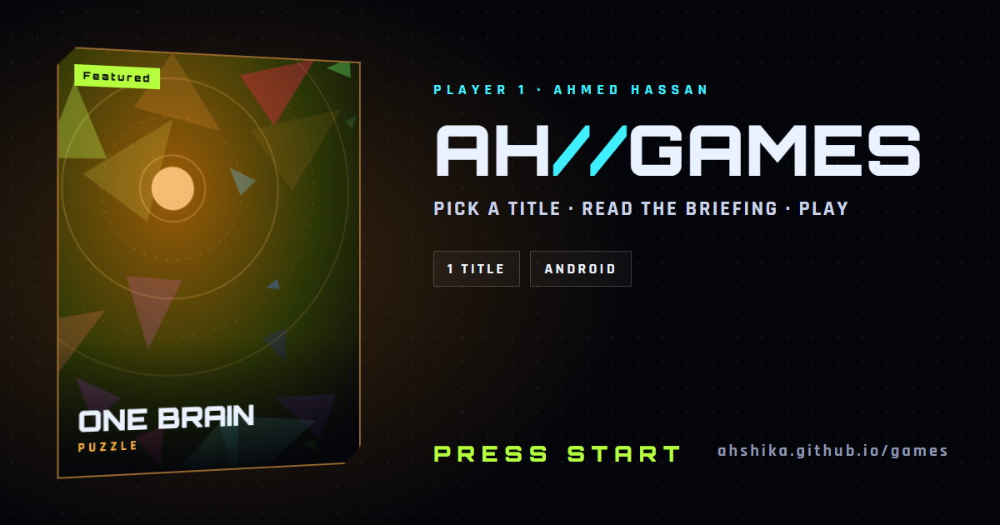

# AH//GAMES

**The games of Ahmed Hassan, presented as a game-select screen.**

[**ahshika.github.io/games**](https://ahshika.github.io/games/) · [Software portfolio](https://ahshika.github.io) · [GitHub](https://github.com/Ahshika)

## The idea

A games portfolio should feel like starting a game, so this one is a console menu:

- **Press start.** A boot screen with a glitching logo waits for any key, a click or the Ⓐ button on a gamepad. Then the launch sequence plays: a loading log with the real number of titles, a hyperspace jump in the featured game's colour, and the menu flies in. Any input skips it; reduced-motion users get a plain fade.
- **Game select.** Every game is a case you can tilt with the mouse, with a holographic sheen. Its briefing shows a **quest log** (what the game does), a **loadout** (what it is built with) and controller-style buttons: Ⓐ download, Ⓨ source.
- **Real controls.** Arrow keys or a gamepad's LB / RB switch titles, Enter or Ⓐ downloads, S or Ⓨ opens the source. Sound effects are synthesized in the browser and off by default.
- **Each game has its own colour**, which tints the whole page and lights up the point field around the cursor.
- **No fake screenshots.** Until a game has real cover art, its case shows abstract key art generated from its name.

Software projects live in the [main portfolio](https://ahshika.github.io); the two never mix.

## Inside

| File | What it is |
|---|---|
| `index.html` | The whole site: one file of HTML, CSS and vanilla JavaScript, no build step |
| `data/games.json` | The games shown on the page (games only) |
| `og.png` | Link-preview image for LinkedIn, WhatsApp and other sites |
| `og-src/og.html` | Source of `og.png`, rendered with headless Chrome; it reads `data/games.json` |
| `assets/` | Real cover art (`cover` field in the data) |
| `tools/validate-games.mjs` + `.github/workflows/validate.yml` | Checks every change: valid data, no software, no duplicates |

## Stays up to date by itself

My automation watches my repositories. When a project I approved as a **game** publishes a release, it updates `data/games.json` (version, platforms, download links) through a pull request, and the validation workflow refuses anything that is not a game.

## Contact

**Ahmed Hassan Mostafa** · Full-stack developer (React) & AI automation · Alexandria, Egypt
[LinkedIn](https://www.linkedin.com/in/ahmed-hassan-3098623ba/) · [GitHub](https://github.com/Ahshika) · [Software portfolio](https://ahshika.github.io)
